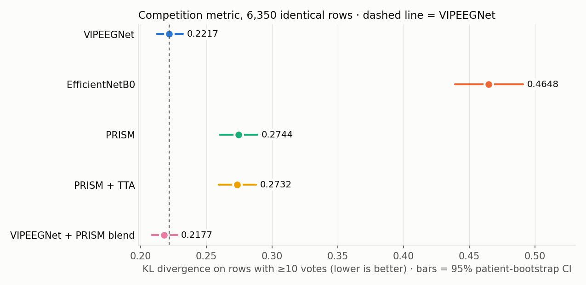
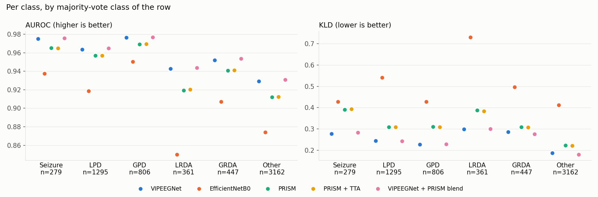
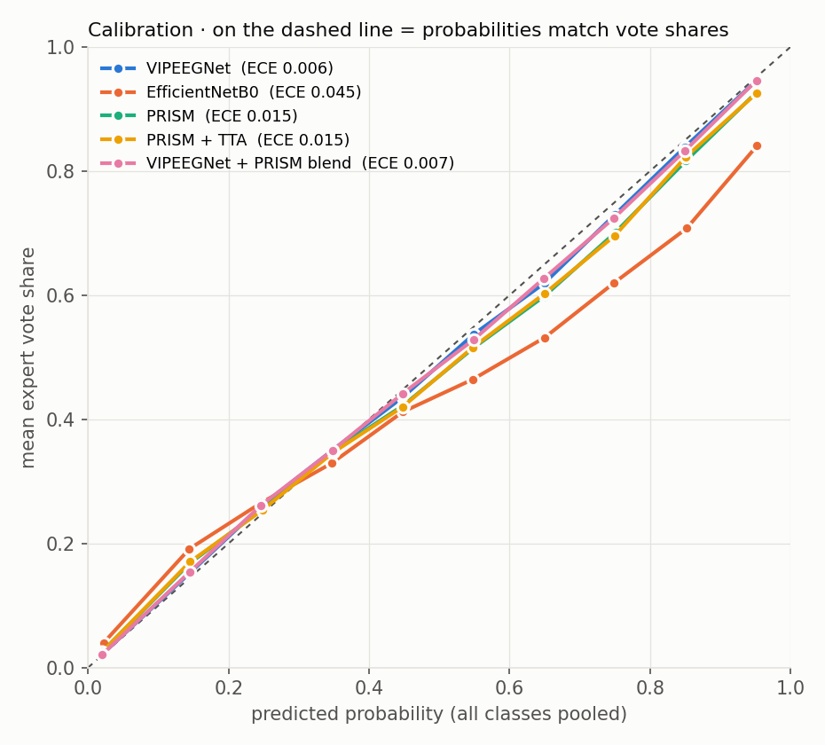
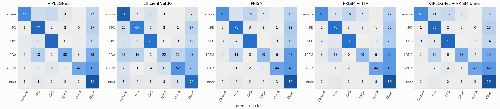

# HMS model comparison (2026-10-19)

6,350 rows with >=10 votes, 1,063 patients; reference VIPEEGNet.

## KLD (95% patient CI)

```
                            KLD  CI low  CI high  vs VIPEEGNet  diff CI low  diff CI high  P(better than ref)  rows better %  KLD all rows
model                                                                                                                                     
VIPEEGNet                0.2217  0.2120   0.2320        0.0000       0.0000        0.0000                 0.0         0.0000        0.5794
EfficientNetB0           0.4648  0.4391   0.4911        0.2431       0.2196        0.2664                 0.0        27.8268        0.6125
PRISM                    0.2744  0.2602   0.2889        0.0527       0.0423        0.0648                 0.0        40.3307        0.6476
PRISM + TTA              0.2732  0.2592   0.2877        0.0516       0.0412        0.0638                 0.0        40.2520        0.6447
VIPEEGNet + PRISM blend  0.2177  0.2082   0.2277       -0.0040      -0.0056       -0.0023                 1.0        54.2362           NaN
```

## Overall metrics

```
                                   KLD  Brier (vs vote shares)  class-wise ECE  accuracy vs majority vote %  macro-F1 %  macro-AUROC  mean max-probability
VIPEEGNet                       0.2217                  0.0776          0.0061                      77.2441     66.2628       0.9564                0.6702
EfficientNetB0                  0.4648                  0.1840          0.0448                      67.3386     55.5827       0.9063                0.6868
PRISM                           0.2744                  0.1007          0.0147                      74.8031     62.5195       0.9438                0.6761
PRISM + TTA                     0.2732                  0.1001          0.0149                      74.8189     62.5268       0.9442                0.6761
VIPEEGNet + PRISM blend         0.2177                  0.0762          0.0074                      77.8110     66.9880       0.9575                0.6723
(experts: mean top vote share)     NaN                     NaN             NaN                          NaN         NaN          NaN                0.7130
```

## Per-class AUROC

```
model    VIPEEGNet  EfficientNetB0   PRISM  PRISM + TTA  VIPEEGNet + PRISM blend
class                                                                           
Seizure     0.9751          0.9375  0.9652       0.9649                   0.9757
LPD         0.9633          0.9185  0.9568       0.9568                   0.9648
GPD         0.9763          0.9502  0.9691       0.9695                   0.9768
LRDA        0.9426          0.8502  0.9194       0.9203                   0.9435
GRDA        0.9521          0.9072  0.9406       0.9411                   0.9536
Other       0.9291          0.8741  0.9120       0.9125                   0.9307
```

## Per-class recall %

```
model    VIPEEGNet  EfficientNetB0    PRISM  PRISM + TTA  VIPEEGNet + PRISM blend
class                                                                            
Seizure    56.2724         81.3620  53.0466      53.4050                  56.9892
LPD        76.8340         63.7066  71.1969      71.0425                  75.9073
GPD        77.5434         70.3474  71.2159      70.5955                  76.9231
LRDA       38.2271         21.8837  29.0859      28.5319                  37.9501
GRDA       41.6107         52.3490  43.8479      44.2953                  42.7293
Other      88.6781         74.1303  88.7097      88.9311                  90.1645
```

## Per fold

```
      VIPEEGNet  EfficientNetB0   PRISM  PRISM + TTA  VIPEEGNet + PRISM blend
fold                                                                         
0        0.2163          0.5117  0.2708       0.2713                   0.2136
1        0.2240          0.4766  0.2694       0.2678                   0.2195
2        0.2241          0.4392  0.2867       0.2853                   0.2202
3        0.2319          0.4594  0.2865       0.2854                   0.2285
4        0.2142          0.4282  0.2610       0.2590                   0.2089
mean     0.2221          0.4630  0.2749       0.2737                   0.2181
std      0.0070          0.0330  0.0114       0.0115                   0.0074
```

## Error correlation

```
                         VIPEEGNet  EfficientNetB0   PRISM  PRISM + TTA  VIPEEGNet + PRISM blend
VIPEEGNet                   1.0000          0.4099  0.6778       0.6764                   0.9868
EfficientNetB0              0.4099          1.0000  0.3941       0.3903                   0.4247
PRISM                       0.6778          0.3941  1.0000       0.9963                   0.7620
PRISM + TTA                 0.6764          0.3903  0.9963       1.0000                   0.7608
VIPEEGNet + PRISM blend     0.9868          0.4247  0.7620       0.7608                   1.0000
```




