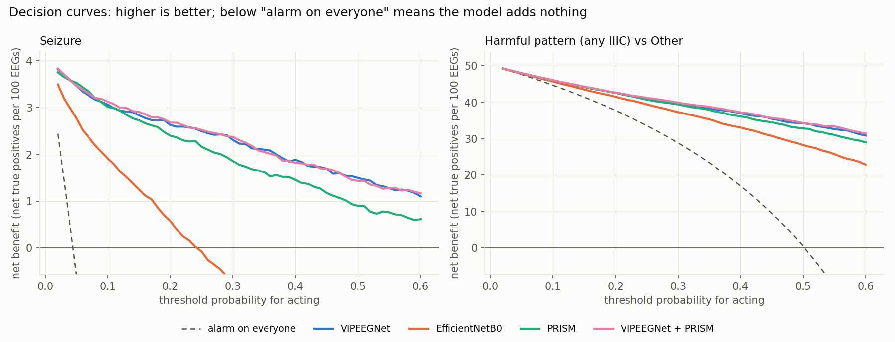
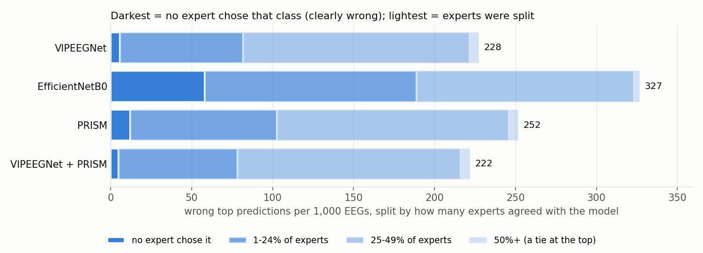
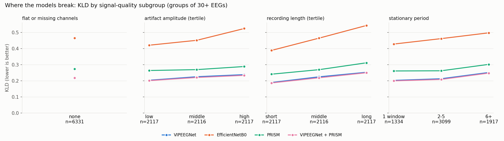
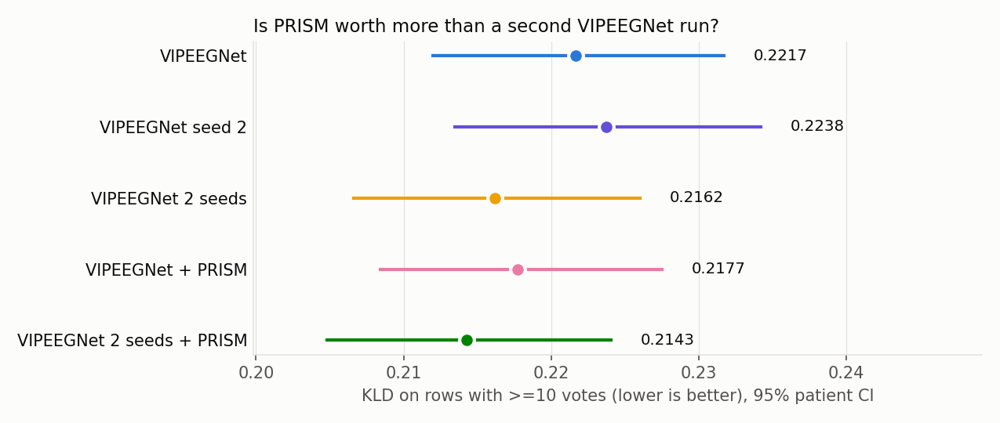
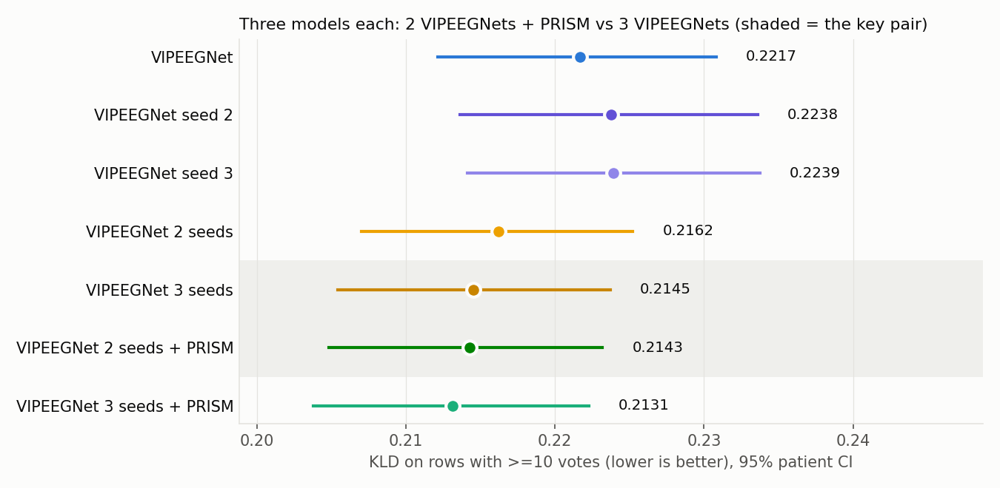

# HMS — extended evaluation (2026-10-25)

6,350 rows with >=10 votes, 1,063 patients. CIs and p-values resample whole patients (1000 resamples).

## A. Stricter statistics

```
                                                         first   second  difference   CI low  CI high       p  first is better  p (Holm)  significant (Holm < 0.05)
comparison                     metric                                                                                                                              
EfficientNetB0 vs VIPEEGNet    KLD                      0.4648   0.2217      0.2431   0.2172   0.2663  0.0000            False    0.0000                       True
                               accuracy %              67.3386  77.2441     -9.9055 -11.6686  -7.9873  0.0000            False    0.0000                       True
                               macro-F1 %              55.5827  66.2628    -10.6801 -13.3107  -8.1331  0.0000            False    0.0000                       True
                               macro-AUROC              0.9063   0.9564     -0.0501  -0.0564  -0.0435  0.0000            False    0.0000                       True
                               seizure AUROC            0.9375   0.9751     -0.0376  -0.0517  -0.0260  0.0000            False    0.0000                       True
                               harmful-vs-Other AUROC   0.8741   0.9291     -0.0550  -0.0647  -0.0456  0.0000            False    0.0000                       True
PRISM vs VIPEEGNet             KLD                      0.2732   0.2217      0.0516   0.0420   0.0638  0.0000            False    0.0000                       True
                               accuracy %              74.8189  77.2441     -2.4252  -3.4537  -1.3897  0.0000            False    0.0001                       True
                               macro-F1 %              62.5268  66.2628     -3.7361  -5.6550  -1.9564  0.0000            False    0.0003                       True
                               macro-AUROC              0.9442   0.9564     -0.0122  -0.0153  -0.0091  0.0000            False    0.0000                       True
                               seizure AUROC            0.9649   0.9751     -0.0102  -0.0161  -0.0042  0.0009            False    0.0045                       True
                               harmful-vs-Other AUROC   0.9125   0.9291     -0.0166  -0.0240  -0.0097  0.0000            False    0.0000                       True
VIPEEGNet + PRISM vs VIPEEGNet KLD                      0.2177   0.2217     -0.0040  -0.0056  -0.0023  0.0000             True    0.0000                       True
                               accuracy %              77.8110  77.2441      0.5669   0.1554   1.0106  0.0073             True    0.0220                       True
                               macro-F1 %              66.9880  66.2628      0.7252  -0.0323   1.4886  0.0694             True    0.1388                      False
                               macro-AUROC              0.9575   0.9564      0.0011   0.0005   0.0017  0.0007             True    0.0043                       True
                               seizure AUROC            0.9757   0.9751      0.0006  -0.0005   0.0017  0.3137             True    0.3137                      False
                               harmful-vs-Other AUROC   0.9307   0.9291      0.0016   0.0005   0.0028  0.0041             True    0.0163                       True
VIPEEGNet + PRISM vs PRISM     KLD                      0.2177   0.2732     -0.0555  -0.0666  -0.0469  0.0000             True    0.0000                       True
                               accuracy %              77.8110  74.8189      2.9921   2.0798   3.9400  0.0000             True    0.0000                       True
                               macro-F1 %              66.9880  62.5268      4.4613   2.8621   6.2061  0.0000             True    0.0000                       True
                               macro-AUROC              0.9575   0.9442      0.0133   0.0107   0.0160  0.0000             True    0.0000                       True
                               seizure AUROC            0.9757   0.9649      0.0108   0.0058   0.0159  0.0000             True    0.0003                       True
                               harmful-vs-Other AUROC   0.9307   0.9125      0.0182   0.0124   0.0248  0.0000             True    0.0000                       True
```

## B. Low-vote rows

Blend weights per fold: {0: 0.2, 1: 0.2, 2: 0.2, 3: 0.2, 4: 0.2}

### KLD

```
model                             VIPEEGNet  EfficientNetB0   PRISM  VIPEEGNet + PRISM
rows                       n                                                          
1 vote                     3452      0.4071          0.5483  0.4396             0.4039
2 votes                    2078      0.5441          0.6521  0.5999             0.5429
3-5 votes                  8161      0.9433          0.7474  1.0349             0.9458
6-7 votes                  142       0.3739          0.4454  0.4702             0.3753
all low-vote rows          13833     0.7437          0.6803  0.8152             0.7442
>=10 votes (for reference) 6350      0.2217          0.4648  0.2732             0.2177
```

### Accuracy vs plurality %

```
model                             VIPEEGNet  EfficientNetB0    PRISM  VIPEEGNet + PRISM
rows                       n                                                           
1 vote                     3452     87.7462         81.0545  86.2399            87.9200
2 votes                    2078     68.8643         69.3936  67.4687            68.6718
3-5 votes                  8161     55.8142         69.2072  54.6134            55.6304
6-7 votes                  142      69.0141         69.7183  64.7887            69.7183
all low-vote rows          13833    65.8787         72.1969  64.5413            65.7919
>=10 votes (for reference) 6350     77.2441         67.3386  74.8189            77.8110
```

### Difference vs VIPEEGNet (patient CI)

```
                   KLD minus VIPEEGNet (low-vote rows)  CI low  CI high
model                                                                  
EfficientNetB0                                 -0.0634 -0.1116  -0.0182
PRISM                                           0.0716  0.0566   0.0886
VIPEEGNet + PRISM                               0.0005 -0.0024   0.0038
```

## C. Net benefit at selected thresholds (x100 = net true positives per 100 EEGs)

```
                                               alarm on everyone  alarm on no one  VIPEEGNet  EfficientNetB0    PRISM  VIPEEGNet + PRISM
task                                threshold                                                                                           
Seizure                             0.05                 -0.6382              0.0     3.4621          2.7634   3.5267             3.4629
                                    0.10                 -6.2292              0.0     3.0656          1.9143   3.0131             3.1269
                                    0.20                -19.5079              0.0     2.6299          0.5748   2.4016             2.6811
                                    0.30                -36.5804              0.0     2.3105         -0.7627   1.8560             2.3757
                                    0.50                -91.2126              0.0     1.4961         -3.4961   0.8976             1.4331
Harmful pattern (any IIIC) vs Other 0.05                 47.5839              0.0    47.9478         47.8375  47.9320            47.9635
                                    0.10                 44.6719              0.0    46.0070         45.6920  45.9948            46.0472
                                    0.20                 37.7559              0.0    42.5945         41.4961  42.5709            42.6378
                                    0.30                 28.8639              0.0    39.7413         37.2913  39.4241            39.9033
                                    0.50                  0.4094              0.0    34.2677         28.2520  32.8189            34.2992
```

## D. Error plausibility (per 1,000 EEGs)

```
model                        VIPEEGNet  EfficientNetB0     PRISM  VIPEEGNet + PRISM
votes for the model's class                                                        
no expert chose it              5.8268         58.1102   12.1260             4.7244
1-24% of experts               76.0630        130.7087   90.5512            73.5433
25-49% of experts             139.6850        134.3307  143.1496           137.7953
50%+ (a tie at the top)         5.9843          3.4646    5.9843             5.8268
```

### Share of each model's errors %

```
model                        VIPEEGNet  EfficientNetB0    PRISM  VIPEEGNet + PRISM
votes for the model's class                                                       
no expert chose it              2.5606         17.7917   4.8155             2.1292
1-24% of experts               33.4256         40.0193  35.9600            33.1441
25-49% of experts              61.3841         41.1283  56.8480            62.1008
50%+ (a tie at the top)         2.6298          1.0608   2.3765             2.6260
```

## E. Calibration fix (T < 1 = predictions sharpened)

```
                   KLD as is  KLD + temperature  KLD + temperature + class bias  gain (as is - T+bias)  gain CI low  gain CI high                  fitted T per fold
model                                                                                                                                                               
VIPEEGNet             0.2217             0.2212                          0.2217                 0.0000      -0.0007        0.0008  1.044, 1.036, 1.046, 1.036, 1.035
EfficientNetB0        0.4648             0.4235                          0.3695                 0.0953       0.0808        0.1103  1.338, 1.368, 1.363, 1.384, 1.375
PRISM                 0.2732             0.2690                          0.2673                 0.0059       0.0035        0.0085  1.113, 1.115, 1.114, 1.104, 1.108
VIPEEGNet + PRISM     0.2177             0.2174                          0.2174                 0.0003      -0.0005        0.0011  1.039, 1.033, 1.042, 1.030, 1.030
```

## F. Signal-quality subgroups (KLD)

### flat or missing channels

```
model       VIPEEGNet  EfficientNetB0   PRISM  VIPEEGNet + PRISM
level n                                                         
none  6331     0.2214          0.4647  0.2732             0.2175
1     6        0.2028          0.4072  0.1855             0.1861
2+    13       0.3514          0.5172  0.3417             0.3350
```

### artifact amplitude (tertile)

```
model        VIPEEGNet  EfficientNetB0   PRISM  VIPEEGNet + PRISM
level  n                                                         
low    2117     0.2028          0.4202  0.2632             0.2003
middle 2116     0.2246          0.4505  0.2686             0.2198
high   2117     0.2376          0.5236  0.2879             0.2331
```

### recording length (tertile)

```
model        VIPEEGNet  EfficientNetB0   PRISM  VIPEEGNet + PRISM
level  n                                                         
short  2117     0.1889          0.3879  0.2404             0.1860
middle 2116     0.2239          0.4639  0.2683             0.2180
long   2117     0.2522          0.5426  0.3111             0.2492
```

### stationary period

```
model          VIPEEGNet  EfficientNetB0   PRISM  VIPEEGNet + PRISM
level    n                                                         
1 window 1334     0.2018          0.4273  0.2603             0.1988
2-5      3099     0.2121          0.4611  0.2615             0.2077
6+       1917     0.2509          0.4969  0.3012             0.2471
```

## G. Seed control

```
                              KLD  CI low  CI high  accuracy %
model                                                         
VIPEEGNet                  0.2217  0.2120   0.2317     77.2441
VIPEEGNet seed 2           0.2238  0.2135   0.2342     77.4646
VIPEEGNet 2 seeds          0.2162  0.2066   0.2260     77.7008
VIPEEGNet + PRISM          0.2177  0.2084   0.2275     77.8110
VIPEEGNet 2 seeds + PRISM  0.2143  0.2048   0.2241     77.5748
```

```
                                                                     comparison  KLD difference  CI low  CI high       p
test                                                                                                                    
seed-to-seed noise                                 VIPEEGNet seed 2 - VIPEEGNet          0.0021 -0.0023   0.0064  0.3574
gain from a second VIPEEGNet                      VIPEEGNet 2 seeds - VIPEEGNet         -0.0055 -0.0077  -0.0035  0.0000
gain from adding PRISM                            VIPEEGNet + PRISM - VIPEEGNet         -0.0040 -0.0057  -0.0023  0.0000
KEY: PRISM vs a second VIPEEGNet          VIPEEGNet + PRISM - VIPEEGNet 2 seeds          0.0015 -0.0005   0.0035  0.1444
PRISM on top of two seeds         VIPEEGNet 2 seeds + PRISM - VIPEEGNet 2 seeds         -0.0020 -0.0031  -0.0008  0.0007
```

## H. Three-seed control

Single seeds: mean 0.2231, SD 0.0013. PRISM weights: 2 seeds [0.15, 0.15, 0.15, 0.15, 0.15], 3 seeds [0.15, 0.15, 0.1, 0.15, 0.15]

```
                           models in it     KLD  CI low  CI high  accuracy %
model                                                                       
VIPEEGNet                             1  0.2217  0.2121   0.2308     77.2441
VIPEEGNet seed 2                      1  0.2238  0.2136   0.2336     77.4646
VIPEEGNet seed 3                      1  0.2239  0.2141   0.2337     77.6378
VIPEEGNet 2 seeds                     2  0.2162  0.2070   0.2252     77.7008
VIPEEGNet 3 seeds                     3  0.2145  0.2054   0.2237     78.0000
VIPEEGNet 2 seeds + PRISM             3  0.2143  0.2048   0.2232     77.5748
VIPEEGNet 3 seeds + PRISM             4  0.2131  0.2038   0.2223     77.9528
```

```
                                                                                    comparison  KLD difference  CI low  CI high       p
test                                                                                                                                   
gain from a third VIPEEGNet                              VIPEEGNet 3 seeds - VIPEEGNet 2 seeds         -0.0017 -0.0026  -0.0007  0.0005
gain from PRISM as the third model               VIPEEGNet 2 seeds + PRISM - VIPEEGNet 2 seeds         -0.0020 -0.0031  -0.0009  0.0005
KEY: PRISM vs a third VIPEEGNet (3 models each)  VIPEEGNet 2 seeds + PRISM - VIPEEGNet 3 seeds         -0.0003 -0.0017   0.0011  0.7188
PRISM on top of three seeds                      VIPEEGNet 3 seeds + PRISM - VIPEEGNet 3 seeds         -0.0014 -0.0025  -0.0004  0.0065
```





