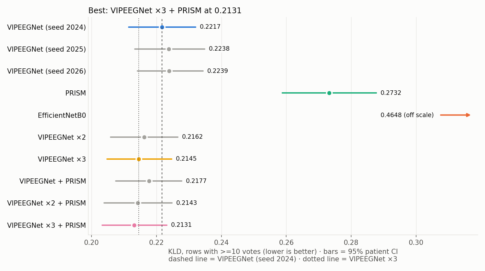
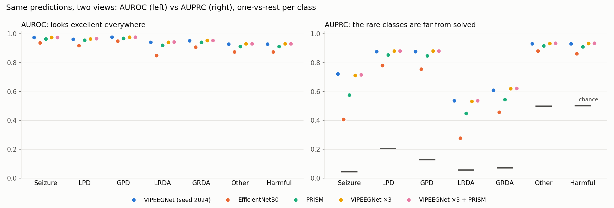
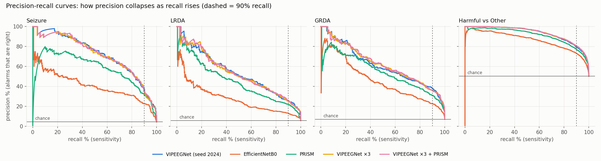
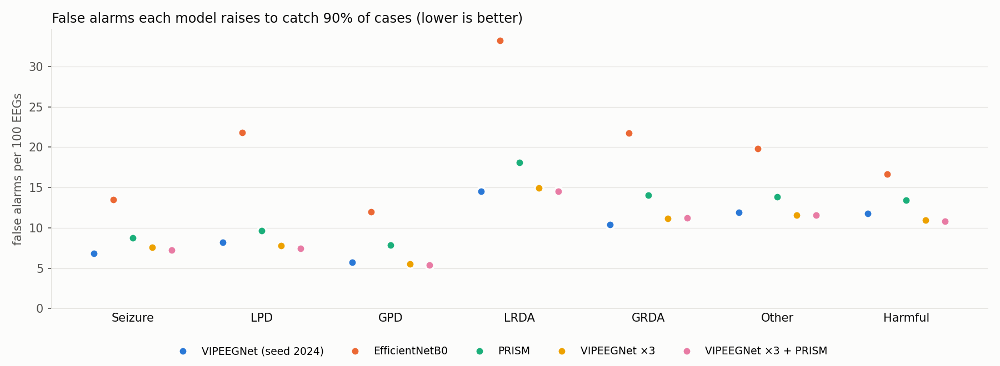
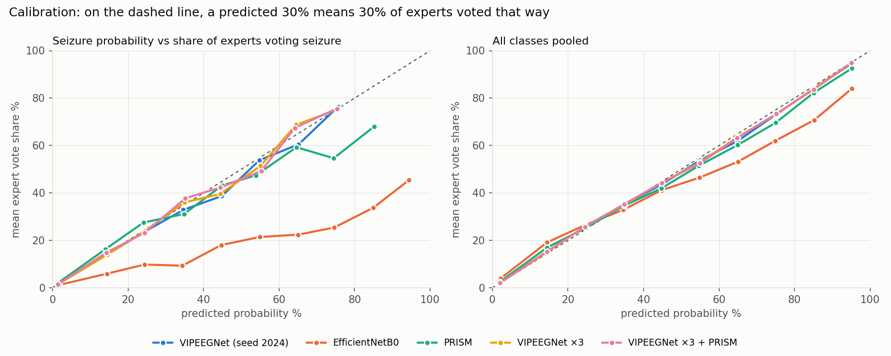
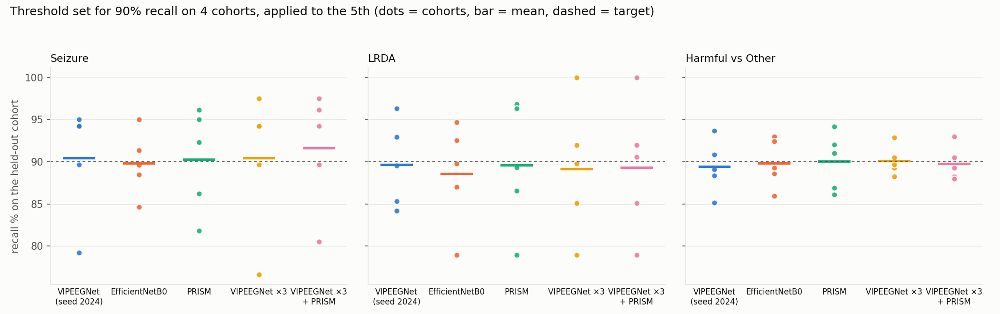
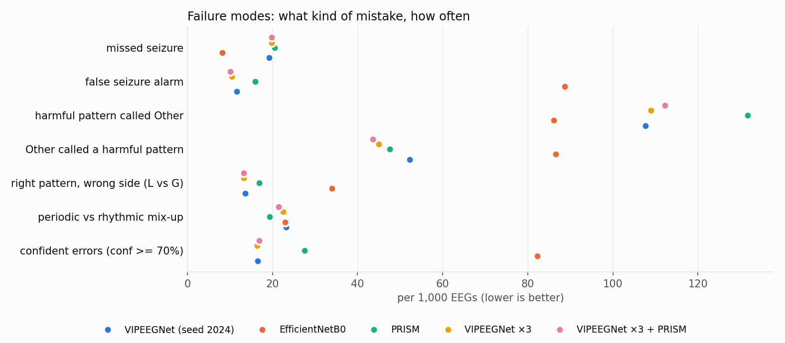
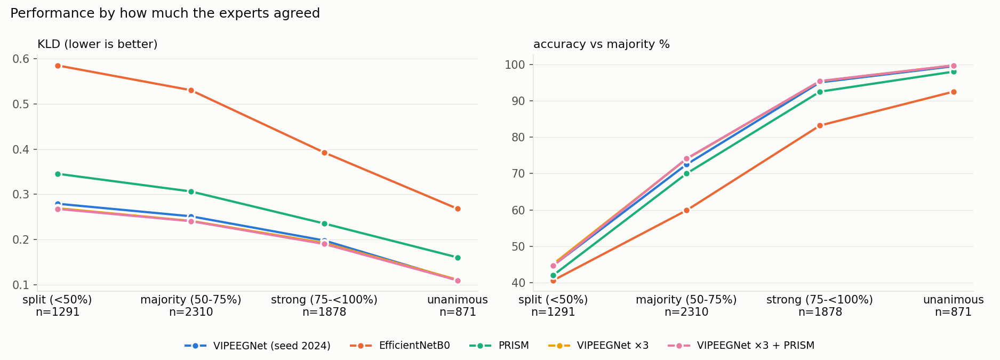
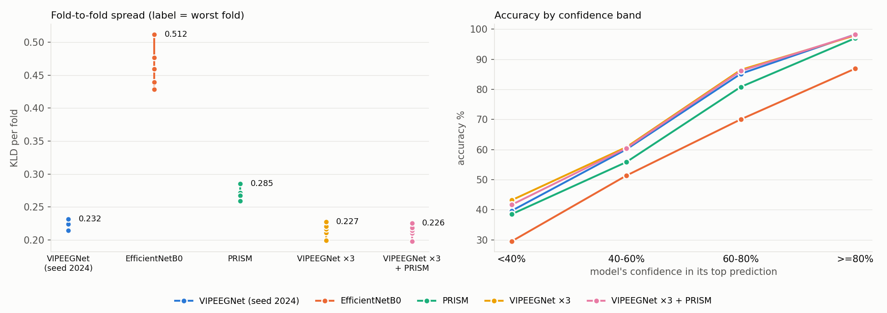
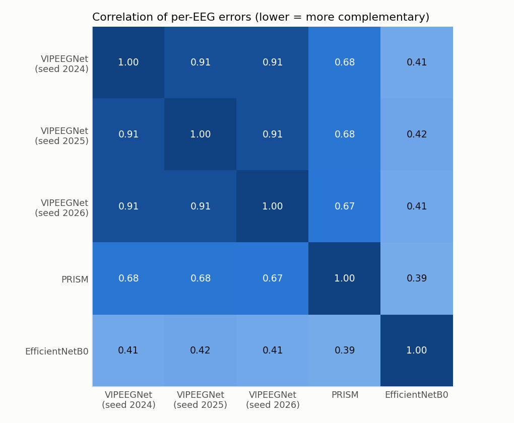

# HMS — full comparison (2026-10-25)

6,350 rows with >=10 votes, 1,063 patients. Baselines: VIPEEGNet (seed 2024) and VIPEEGNet ×3. CIs resample whole patients.

## Answers

- **Q1.** Lowest KLD: VIPEEGNet ×3 + PRISM (0.2131) vs VIPEEGNet (seed 2024) 0.2217 and VIPEEGNet ×3 0.2145. Real vs VIPEEGNet ×3: True (difference -0.0014, CI -0.0024 to -0.0004).

- **Q2.** KLD varies by SD 0.0013 (range 0.0022) across 3 seeds; accuracy by SD 0.20 points. Differences smaller than about two SDs are within seed luck.

- **Q3.** Seizure (prevalence 4.4%): AUROC 0.937-0.976 across models, but AUPRC only 0.408-0.728; best AUPRC VIPEEGNet + PRISM. Largest AUROC-AUPRC gap: LRDA. Targets where the AUPRC winner differs from the AUROC winner: ['GRDA', 'Other'].

- **Q4.** At 90% seizure recall: VIPEEGNet + PRISM raises 6.4 false alarms per 100 EEGs vs 6.8 for VIPEEGNet (seed 2024) and 13.5 for EfficientNetB0. For harmful-vs-Other at 90% recall: 10.8 (VIPEEGNet ×3 + PRISM) to 16.7 per 100 EEGs.

- **Q5.** Best calibrated: VIPEEGNet ×3 (class-wise ECE 0.0060); worst: EfficientNetB0 (0.0448). Seizure slope ranges 0.39-0.97.

- **Q6.** A seizure threshold set for 90% recall on other patients catches 89.8-91.6% on new patients on average; the worst cohort drops to 76.6% (VIPEEGNet (seed 2025)). Most stable seizure threshold (lowest relative drift): EfficientNetB0.

- **Q7.** Most common failure for VIPEEGNet (seed 2024): "harmful pattern called Other" (108 per 1,000). Fewest errors overall: VIPEEGNet ×3 (220/1,000); fewest confident errors: VIPEEGNet ×2 (15.0/1,000).

- **Q8.** On split-vote EEGs (n=1291) the best is VIPEEGNet ×3 + PRISM (KLD 0.2676); VIPEEGNet (seed 2024) 0.2791. Uncertainty tracks expert disagreement best for VIPEEGNet ×3 + PRISM (rho 0.741); experts' top-2 reproduced in up to 70.4% of two-way cases.

- **Q9.** Best worst-fold floor: VIPEEGNet ×3 + PRISM (0.2259); VIPEEGNet (seed 2024) worst fold 0.2319. Patients with KLD > 0.5: 4.9% (VIPEEGNet + PRISM) to 33.4%. When VIPEEGNet (seed 2024) is >=80% confident it is right 98.3% of the time.

- **Q10.** VIPEEGNet seeds correlate with each other at r=0.913; PRISM vs VIPEEGNet (seed 2024) r=0.676; EfficientNetB0 vs VIPEEGNet (seed 2024) r=0.410. Lower r = more complementary errors.

- **Q11.** Largest gain per extra member: VIPEEGNet ×2 (0.0055); largest gain per extra 10M parameters: VIPEEGNet + PRISM (0.0134).

- **Verdict.** Most question wins: VIPEEGNet ×3 + PRISM (5 of 14). VIPEEGNet ×3 + PRISM vs VIPEEGNet ×3: KLD -0.0014 (CI -0.0024 to -0.0004), macro-AUPRC +0.0020 (CI 0.0001 to 0.0043). Single-model ranking by KLD: VIPEEGNet (seed 2024) < VIPEEGNet (seed 2025) < VIPEEGNet (seed 2026) < PRISM < EfficientNetB0.

## 1. Overall

```
                       members     KLD        KLD 95% CI  vs VIPEEGNet (seed 2024) vs VIPEEGNet (seed 2024) CI  real vs VIPEEGNet (seed 2024)  vs VIPEEGNet ×3  vs VIPEEGNet ×3 CI  real vs VIPEEGNet ×3  accuracy %  macro-F1 %  macro-AUROC  macro-AUPRC   Brier
model                                                                                                                                                                                                                                                             
VIPEEGNet (seed 2024)        1  0.2217  0.2114 to 0.2321                    0.0000            0.0000 to 0.0000                          False           0.0072    0.0049 to 0.0096                  True     77.2441     66.2628       0.9564       0.7589  0.0776
VIPEEGNet (seed 2025)        1  0.2238  0.2133 to 0.2348                    0.0021           -0.0026 to 0.0064                          False           0.0092    0.0066 to 0.0119                  True     77.4646     65.8978       0.9550       0.7480  0.0790
VIPEEGNet (seed 2026)        1  0.2239  0.2141 to 0.2343                    0.0022           -0.0013 to 0.0058                          False           0.0094    0.0075 to 0.0117                  True     77.6378     66.3140       0.9549       0.7493  0.0791
PRISM                        1  0.2732  0.2588 to 0.2877                    0.0516            0.0420 to 0.0638                           True           0.0587    0.0491 to 0.0706                  True     74.8189     62.5268       0.9442       0.6977  0.1001
EfficientNetB0               1  0.4648  0.4387 to 0.4914                    0.2431            0.2172 to 0.2663                           True           0.2503    0.2243 to 0.2734                  True     67.3386     55.5827       0.9063       0.5936  0.1840
VIPEEGNet ×2                 2  0.2162  0.2059 to 0.2266                   -0.0055          -0.0078 to -0.0032                           True           0.0017    0.0007 to 0.0026                  True     77.7008     66.4899       0.9572       0.7596  0.0757
VIPEEGNet ×3                 3  0.2145  0.2047 to 0.2247                   -0.0072          -0.0096 to -0.0049                           True           0.0000    0.0000 to 0.0000                 False     78.0000     66.7182       0.9574       0.7602  0.0751
VIPEEGNet + PRISM            2  0.2177  0.2074 to 0.2277                   -0.0040          -0.0056 to -0.0023                           True           0.0032    0.0012 to 0.0055                  True     77.8110     66.9880       0.9575       0.7633  0.0762
VIPEEGNet ×2 + PRISM         3  0.2143  0.2039 to 0.2248                   -0.0074          -0.0103 to -0.0047                           True          -0.0003   -0.0017 to 0.0011                 False     77.5748     66.1346       0.9578       0.7623  0.0751
VIPEEGNet ×3 + PRISM         4  0.2131  0.2032 to 0.2232                   -0.0086          -0.0116 to -0.0059                           True          -0.0014  -0.0024 to -0.0004                  True     77.9528     66.5929       0.9580       0.7622  0.0747
```

### Improvement ladder (negative = better)

```
                                                from                    to  KLD change              95% CI       p  real?
step                                                                                                                     
add a 2nd VIPEEGNet seed       VIPEEGNet (seed 2024)          VIPEEGNet ×2     -0.0055  -0.0078 to -0.0032  0.0000   True
add a 3rd VIPEEGNet seed                VIPEEGNet ×2          VIPEEGNet ×3     -0.0017  -0.0026 to -0.0007  0.0008   True
add PRISM to one VIPEEGNet     VIPEEGNet (seed 2024)     VIPEEGNet + PRISM     -0.0040  -0.0056 to -0.0023  0.0000   True
add PRISM to two seeds                  VIPEEGNet ×2  VIPEEGNet ×2 + PRISM     -0.0020  -0.0030 to -0.0009  0.0004   True
add PRISM to three seeds                VIPEEGNet ×3  VIPEEGNet ×3 + PRISM     -0.0014  -0.0024 to -0.0004  0.0063   True
PRISM instead of the 3rd seed           VIPEEGNet ×3  VIPEEGNet ×2 + PRISM     -0.0003   -0.0017 to 0.0011  0.7226  False
```

## 2. Seed noise

```
             mean of seeds  SD across seeds   range VIPEEGNet ×3 minus VIPEEGNet (seed 2024) VIPEEGNet ×3 + PRISM minus VIPEEGNet ×3 ensemble gain in seed SDs
KLD                 0.2231           0.0013  0.0022                                -0.007154                               -0.001399                 -7.975032
accuracy %         77.4488           0.1973  0.3937                                 0.755906                               -0.047244                  2.553878
macro-F1 %         66.1582           0.2269  0.4162                                 0.455389                               -0.125263                  1.915586
macro-AUROC         0.9554           0.0009  0.0015                                 0.001012                                0.000532                  2.945969
macro-AUPRC         0.7521           0.0060  0.0109                                 0.001253                                0.001995                   1.69183
Brier               0.0786           0.0008  0.0015                                -0.002518                               -0.000401                 -4.611638
```

## 3. AUROC vs AUPRC

### AUPRC

```
model                        VIPEEGNet (seed 2024)  VIPEEGNet (seed 2025)  VIPEEGNet (seed 2026)   PRISM  EfficientNetB0  VIPEEGNet ×2  VIPEEGNet ×3  VIPEEGNet + PRISM  VIPEEGNet ×2 + PRISM  VIPEEGNet ×3 + PRISM
target                                                                                                                                                                                                             
Seizure                                     0.7222                 0.6882                 0.6955  0.5753          0.4081        0.7140        0.7130             0.7276                0.7209                0.7169
LPD                                         0.8777                 0.8771                 0.8729  0.8544          0.7805        0.8810        0.8810             0.8801                0.8819                0.8817
GPD                                         0.8768                 0.8741                 0.8764  0.8472          0.7563        0.8794        0.8808             0.8790                0.8809                0.8815
LRDA                                        0.5360                 0.5048                 0.5059  0.4496          0.2784        0.5326        0.5319             0.5447                0.5367                0.5355
GRDA                                        0.6098                 0.6105                 0.6148  0.5439          0.4572        0.6163        0.6203             0.6157                0.6188                0.6227
Other                                       0.9310                 0.9332                 0.9304  0.9160          0.8809        0.9340        0.9342             0.9328                0.9347                0.9348
Harmful (any IIIC) vs Other                 0.9323                 0.9326                 0.9295  0.9105          0.8631        0.9343        0.9342             0.9337                0.9350                0.9347
```

### AUPRC lift over chance

```
model                        VIPEEGNet (seed 2024)  VIPEEGNet (seed 2025)  VIPEEGNet (seed 2026)    PRISM  EfficientNetB0  VIPEEGNet ×2  VIPEEGNet ×3  VIPEEGNet + PRISM  VIPEEGNet ×2 + PRISM  VIPEEGNet ×3 + PRISM
target                                                                                                                                                                                                              
Seizure                                    16.4380                15.6644                15.8293  13.0935          9.2877       16.2515       16.2267            16.5599               16.4072               16.3170
LPD                                         4.3040                 4.3008                 4.2802   4.1894          3.8274        4.3201        4.3199             4.3157                4.3242                4.3233
GPD                                         6.9079                 6.8869                 6.9049   6.6743          5.9581        6.9285        6.9395             6.9249                6.9398                6.9452
LRDA                                        9.4288                 8.8800                 8.8991   7.9093          4.8974        9.3682        9.3554             9.5817                9.4408                9.4192
GRDA                                        8.6624                 8.6725                 8.7341   7.7265          6.4952        8.7550        8.8121             8.7470                8.7909                8.8456
Other                                       1.8697                 1.8741                 1.8685   1.8395          1.7691        1.8756        1.8761             1.8733                1.8771                1.8773
Harmful (any IIIC) vs Other                 1.8569                 1.8576                 1.8514   1.8135          1.7192        1.8609        1.8607             1.8597                1.8624                1.8618
```

### AUROC

```
model                        VIPEEGNet (seed 2024)  VIPEEGNet (seed 2025)  VIPEEGNet (seed 2026)   PRISM  EfficientNetB0  VIPEEGNet ×2  VIPEEGNet ×3  VIPEEGNet + PRISM  VIPEEGNet ×2 + PRISM  VIPEEGNet ×3 + PRISM
target                                                                                                                                                                                                             
Seizure                                     0.9751                 0.9716                 0.9727  0.9649          0.9375        0.9743        0.9744             0.9757                0.9749                0.9751
LPD                                         0.9633                 0.9648                 0.9630  0.9568          0.9185        0.9652        0.9653             0.9648                0.9659                0.9658
GPD                                         0.9763                 0.9753                 0.9762  0.9695          0.9502        0.9767        0.9770             0.9768                0.9770                0.9772
LRDA                                        0.9426                 0.9353                 0.9392  0.9203          0.8502        0.9415        0.9423             0.9435                0.9423                0.9428
GRDA                                        0.9521                 0.9528                 0.9507  0.9411          0.9072        0.9539        0.9538             0.9536                0.9547                0.9546
Other                                       0.9291                 0.9302                 0.9275  0.9125          0.8741        0.9315        0.9317             0.9307                0.9323                0.9322
Harmful (any IIIC) vs Other                 0.9291                 0.9302                 0.9275  0.9125          0.8741        0.9315        0.9317             0.9307                0.9323                0.9322
```

### Macro averages

```
                        AUROC   AUPRC macro-AUPRC 95% CI
model                                                   
VIPEEGNet (seed 2024)  0.9564  0.7589     0.736 to 0.786
VIPEEGNet (seed 2025)  0.9550  0.7480     0.723 to 0.777
VIPEEGNet (seed 2026)  0.9549  0.7493     0.725 to 0.776
PRISM                  0.9442  0.6977     0.674 to 0.730
EfficientNetB0         0.9063  0.5936     0.568 to 0.622
VIPEEGNet ×2           0.9572  0.7596     0.735 to 0.786
VIPEEGNet ×3           0.9574  0.7602     0.737 to 0.786
VIPEEGNet + PRISM      0.9575  0.7633     0.740 to 0.790
VIPEEGNet ×2 + PRISM   0.9578  0.7623     0.738 to 0.789
VIPEEGNet ×3 + PRISM   0.9580  0.7622     0.739 to 0.788
```

## 4. False alarms per 100 EEGs at 90% recall

```
model                        VIPEEGNet (seed 2024)  VIPEEGNet (seed 2025)  VIPEEGNet (seed 2026)    PRISM  EfficientNetB0  VIPEEGNet ×2  VIPEEGNet ×3  VIPEEGNet + PRISM  VIPEEGNet ×2 + PRISM  VIPEEGNet ×3 + PRISM
target                                                                                                                                                                                                              
Seizure                                     6.8189                 8.3622                 8.8976   8.7874         13.5276        7.5276        7.5591             6.4094                7.4803                7.2441
LPD                                         8.1890                 7.7795                 8.3307   9.6850         21.7953        7.7953        7.8268             7.5748                7.5118                7.4803
GPD                                         5.7323                 6.0630                 5.5118   7.8740         11.9685        5.5276        5.5276             5.5906                5.4488                5.4173
LRDA                                       14.5354                17.4646                16.2520  18.0945         33.2126       15.5118       14.9764            14.2205               14.6142               14.5512
GRDA                                       10.4252                11.7008                12.1732  14.0787         21.7323       10.7717       11.1969            10.6142               10.9606               11.2598
Other                                      11.9213                11.7008                11.8898  13.8583         19.8425       11.4016       11.5433            11.3858               11.3228               11.5748
Harmful (any IIIC) vs Other                11.7795                10.9764                11.5906  13.4646         16.6772       11.0709       10.9291            11.3071               11.0394               10.8031
```

### False alarms per true detection at 90% recall

```
model                        VIPEEGNet (seed 2024)  VIPEEGNet (seed 2025)  VIPEEGNet (seed 2026)   PRISM  EfficientNetB0  VIPEEGNet ×2  VIPEEGNet ×3  VIPEEGNet + PRISM  VIPEEGNet ×2 + PRISM  VIPEEGNet ×3 + PRISM
target                                                                                                                                                                                                             
Seizure                                     1.7183                 2.1071                 2.2421  2.2143          3.4087        1.8968        1.9048             1.6151                1.8849                1.8254
LPD                                         0.4452                 0.4237                 0.4533  0.5274          1.1870        0.4245        0.4262             0.4125                0.4091                0.4070
GPD                                         0.5014                 0.5303                 0.4821  0.6887          1.0454        0.4835        0.4835             0.4890                0.4766                0.4738
LRDA                                        2.8400                 3.4123                 3.1754  3.5354          6.4892        3.0308        2.9262             2.7785                2.8554                2.8431
GRDA                                        1.6386                 1.8437                 1.9181  2.2184          3.4243        1.6973        1.7643             1.6725                1.7228                1.7742
Other                                       0.2659                 0.2611                 0.2652  0.3091          0.4427        0.2544        0.2576             0.2540                0.2526                0.2582
Harmful (any IIIC) vs Other                 0.2606                 0.2429                 0.2564  0.2979          0.3683        0.2449        0.2418             0.2502                0.2440                0.2389
```

## 5. Calibration

```
                       class-wise ECE   Brier  slope Seizure  over-call Seizure (pts)  slope LPD  over-call LPD (pts)  slope GPD  over-call GPD (pts)  slope LRDA  over-call LRDA (pts)  slope GRDA  over-call GRDA (pts)  slope Other  over-call Other (pts)
model                                                                                                                                                                                                                                                        
VIPEEGNet (seed 2024)          0.0061  0.0776         0.9437                   0.1234     0.9818              -0.2033     0.9885              -0.1328      1.0110               -0.4393      1.0073               -0.2978       0.9856                 0.9498
VIPEEGNet (seed 2025)          0.0082  0.0790         0.9164                   0.1558     0.9729              -0.0823     0.9811              -0.2670      0.9944               -0.5543      1.0045               -0.4091       0.9815                 1.1569
VIPEEGNet (seed 2026)          0.0064  0.0791         0.9670                  -0.0373     0.9695               0.0013     0.9929              -0.2423      0.9899               -0.4221      0.9985               -0.1783       0.9801                 0.8787
PRISM                          0.0149  0.1001         0.8296                  -0.2450     0.9833              -1.5260     0.9755              -0.8464      0.9705               -0.6239      0.8923                0.6143       0.9589                 2.6270
EfficientNetB0                 0.0448  0.1840         0.3943                   7.0847     0.8763              -1.6477     0.8735              -0.1411      0.7235               -1.5901      0.6078                1.6213       0.8199                -5.3270
VIPEEGNet ×2                   0.0064  0.0757         0.9447                   0.1396     0.9850              -0.1428     0.9930              -0.1999      1.0219               -0.4968      1.0184               -0.3534       0.9920                 1.0533
VIPEEGNet ×3                   0.0060  0.0751         0.9623                   0.0807     0.9856              -0.0948     0.9972              -0.2140      1.0251               -0.4719      1.0208               -0.2950       0.9945                 0.9951
VIPEEGNet + PRISM              0.0074  0.0762         0.9603                  -0.0403     0.9903              -0.5040     0.9948              -0.3217      1.0442               -0.5625      1.0073               -0.1800       0.9914                 1.6085
VIPEEGNet ×2 + PRISM           0.0076  0.0751         0.9582                   0.0122     0.9906              -0.3754     0.9972              -0.3319      1.0435               -0.5774      1.0163               -0.2545       0.9951                 1.5270
VIPEEGNet ×3 + PRISM           0.0073  0.0747         0.9724                  -0.0357     0.9902              -0.3187     1.0004              -0.3360      1.0442               -0.5543      1.0182               -0.2087       0.9964                 1.4534
```

## 6. Threshold stability

### (a) Drift of the 90%-recall threshold across cohorts

```
                                                   threshold mean  threshold SD  threshold range  relative drift (SD/mean) %
target                      model                                                                                           
Seizure                     VIPEEGNet (seed 2024)          0.1642        0.0737           0.1597                     44.8420
LRDA                        VIPEEGNet (seed 2024)          0.1218        0.0348           0.0878                     28.5995
Harmful (any IIIC) vs Other VIPEEGNet (seed 2024)          0.4725        0.0290           0.0731                      6.1473
Seizure                     VIPEEGNet (seed 2025)          0.1481        0.0518           0.1176                     34.9573
LRDA                        VIPEEGNet (seed 2025)          0.1170        0.0464           0.1132                     39.6354
Harmful (any IIIC) vs Other VIPEEGNet (seed 2025)          0.4719        0.0113           0.0283                      2.3857
Seizure                     VIPEEGNet (seed 2026)          0.1511        0.0612           0.1650                     40.4847
LRDA                        VIPEEGNet (seed 2026)          0.1272        0.0431           0.1013                     33.9125
Harmful (any IIIC) vs Other VIPEEGNet (seed 2026)          0.4696        0.0190           0.0458                      4.0485
Seizure                     PRISM                          0.0970        0.0300           0.0690                     30.9828
LRDA                        PRISM                          0.0920        0.0469           0.1202                     51.0018
Harmful (any IIIC) vs Other PRISM                          0.4361        0.0387           0.0898                      8.8660
Seizure                     EfficientNetB0                 0.2228        0.0488           0.1196                     21.8945
LRDA                        EfficientNetB0                 0.0413        0.0142           0.0363                     34.3592
Harmful (any IIIC) vs Other EfficientNetB0                 0.5072        0.0461           0.1105                      9.0962
Seizure                     VIPEEGNet ×2                   0.1588        0.0668           0.1488                     42.0811
LRDA                        VIPEEGNet ×2                   0.1188        0.0358           0.0929                     30.1673
Harmful (any IIIC) vs Other VIPEEGNet ×2                   0.4766        0.0196           0.0496                      4.1229
Seizure                     VIPEEGNet ×3                   0.1591        0.0608           0.1406                     38.2282
LRDA                        VIPEEGNet ×3                   0.1272        0.0426           0.1060                     33.4935
Harmful (any IIIC) vs Other VIPEEGNet ×3                   0.4762        0.0150           0.0324                      3.1431
Seizure                     VIPEEGNet + PRISM              0.1464        0.0528           0.1140                     36.0891
LRDA                        VIPEEGNet + PRISM              0.1271        0.0379           0.0961                     29.7761
Harmful (any IIIC) vs Other VIPEEGNet + PRISM              0.4657        0.0298           0.0762                      6.4047
Seizure                     VIPEEGNet ×2 + PRISM           0.1491        0.0583           0.1253                     39.0742
LRDA                        VIPEEGNet ×2 + PRISM           0.1208        0.0425           0.1128                     35.1734
Harmful (any IIIC) vs Other VIPEEGNet ×2 + PRISM           0.4683        0.0213           0.0524                      4.5542
Seizure                     VIPEEGNet ×3 + PRISM           0.1483        0.0579           0.1280                     39.0491
LRDA                        VIPEEGNet ×3 + PRISM           0.1269        0.0434           0.1081                     34.1545
Harmful (any IIIC) vs Other VIPEEGNet ×3 + PRISM           0.4720        0.0175           0.0397                      3.7146
```

### (b) Transfer to new patients

```
                                                   mean held-out recall %  worst cohort recall %  recall SD  mean false alarms /100  worst cohort false alarms /100
target                      model                                                                                                                                  
Harmful (any IIIC) vs Other EfficientNetB0                        89.8406                85.9351     2.9190                 16.5000                         17.9821
                            PRISM                                 90.0340                86.0896     3.4447                 13.4840                         14.9784
                            VIPEEGNet (seed 2024)                 89.4239                85.1623     3.1349                 11.6132                         12.7907
                            VIPEEGNet (seed 2025)                 89.9471                89.0756     1.1719                 10.9737                         11.6450
                            VIPEEGNet (seed 2026)                 89.8014                86.8908     1.8668                 11.5745                         12.7753
                            VIPEEGNet + PRISM                     89.6745                84.8532     3.6142                 11.2082                         13.1541
                            VIPEEGNet ×2                          89.9635                87.4807     2.1476                 11.0417                         11.9913
                            VIPEEGNet ×2 + PRISM                  89.7008                86.8624     2.6056                 10.9012                         11.9186
                            VIPEEGNet ×3                          90.1143                88.2353     1.7510                 10.9236                         11.6450
                            VIPEEGNet ×3 + PRISM                  89.8001                87.9444     2.0610                 10.7268                         11.4007
LRDA                        EfficientNetB0                        88.5904                78.9474     6.1089                 34.3043                         37.1033
                            PRISM                                 89.5989                78.9474     7.4188                 18.6034                         28.4157
                            VIPEEGNet (seed 2024)                 89.6612                84.2105     5.0758                 14.7273                         21.2209
                            VIPEEGNet (seed 2025)                 89.6033                81.5789     7.6872                 17.7950                         21.1726
                            VIPEEGNet (seed 2026)                 89.8410                81.5789     7.0596                 16.1964                         21.4390
                            VIPEEGNet + PRISM                     88.6874                76.3158     8.0822                 14.2795                         20.7849
                            VIPEEGNet ×2                          90.0138                81.5789     6.6177                 15.5442                         20.2035
                            VIPEEGNet ×2 + PRISM                  89.4238                78.9474     7.9989                 14.4073                         19.0407
                            VIPEEGNet ×3                          89.1572                78.9474     7.8569                 15.1390                         19.6948
                            VIPEEGNet ×3 + PRISM                  89.3146                78.9474     7.8800                 14.6698                         19.6221
Seizure                     EfficientNetB0                        89.8133                84.6154     3.8158                 13.4870                         17.2498
                            PRISM                                 90.2973                81.8182     6.1050                  8.4020                         10.6678
                            VIPEEGNet (seed 2024)                 90.4675                79.2208     6.6336                  7.0243                          8.4691
                            VIPEEGNet (seed 2025)                 90.4082                76.6234     8.0542                  8.0975                          9.4463
                            VIPEEGNet (seed 2026)                 90.7928                76.6234     8.2119                  8.1662                         10.2606
                            VIPEEGNet + PRISM                     91.1516                80.5195     6.9940                  6.5503                          8.6319
                            VIPEEGNet ×2                          90.4675                79.2208     6.6336                  7.6297                          9.1205
                            VIPEEGNet ×2 + PRISM                  91.6119                80.5195     6.8744                  7.2183                          9.0391
                            VIPEEGNet ×3                          90.4480                76.6234     8.2173                  7.7118                          9.3648
                            VIPEEGNet ×3 + PRISM                  91.6119                80.5195     6.8744                  7.3032                          9.3648
```

## 7. Failure modes (per 1,000 EEGs)

```
                       missed seizure  false seizure alarm  harmful pattern called Other  Other called a harmful pattern  right pattern, wrong side (L vs G)  periodic vs rhythmic mix-up  all errors  confident errors (conf >= 70%)  share of errors that are confident %
model                                                                                                                                                                                                                                                                      
VIPEEGNet (seed 2024)         19.2126              11.6535                      107.7165                         52.2835                             13.5433                      23.1496    227.5591                         16.5354                                7.2664
VIPEEGNet (seed 2025)         20.3150              11.8110                      110.3937                         46.9291                             13.3858                      22.5197    225.3543                         18.1102                                8.0363
VIPEEGNet (seed 2026)         20.9449               9.9213                      107.7165                         48.3465                             12.9134                      23.7795    223.6220                         18.7402                                8.3803
PRISM                         20.4724              15.9055                      131.6535                         47.5591                             16.8504                      19.3701    251.8110                         27.5591                               10.9443
EfficientNetB0                 8.1890              88.6614                       86.1417                         86.6142                             34.0157                      22.9921    326.6142                         82.2047                               25.1688
VIPEEGNet ×2                  19.5276              11.6535                      108.8189                         47.4016                             13.7008                      21.8898    222.9921                         14.9606                                6.7090
VIPEEGNet ×3                  19.8425              10.3937                      108.9764                         45.0394                             13.2283                      22.5197    220.0000                         16.3780                                7.4445
VIPEEGNet + PRISM             18.8976              11.4961                      112.5984                         44.8819                             13.3858                      20.6299    221.8898                         18.1102                                8.1618
VIPEEGNet ×2 + PRISM          19.6850              11.0236                      114.3307                         45.3543                             13.3858                      20.4724    224.2520                         16.0630                                7.1629
VIPEEGNet ×3 + PRISM          19.8425              10.0787                      112.2835                         43.6220                             13.2283                      21.4173    220.4724                         16.8504                                7.6429
```

### Most frequent confusions (true -> predicted, count)

```
                                 #1 confusion         #2 confusion         #3 confusion
model                                                                                  
VIPEEGNet (seed 2024)      LPD -> Other (225)  GRDA -> Other (215)  LRDA -> Other (136)
VIPEEGNet (seed 2025)      LPD -> Other (223)  GRDA -> Other (216)  LRDA -> Other (145)
VIPEEGNet (seed 2026)     GRDA -> Other (217)   LPD -> Other (206)  LRDA -> Other (144)
PRISM                      LPD -> Other (279)  GRDA -> Other (220)  LRDA -> Other (179)
EfficientNetB0         Other -> Seizure (268)  Other -> GRDA (245)   LPD -> Other (221)
VIPEEGNet ×2              GRDA -> Other (224)   LPD -> Other (222)  LRDA -> Other (136)
VIPEEGNet ×3              GRDA -> Other (226)   LPD -> Other (213)  LRDA -> Other (139)
VIPEEGNet + PRISM          LPD -> Other (239)  GRDA -> Other (221)  LRDA -> Other (143)
VIPEEGNet ×2 + PRISM       LPD -> Other (234)  GRDA -> Other (230)  LRDA -> Other (151)
VIPEEGNet ×3 + PRISM      GRDA -> Other (231)   LPD -> Other (219)  LRDA -> Other (150)
```

## 8. Soft-label fidelity

```
                       entropy tracking (Spearman)  top-2 matches experts' top-2 % (2nd choice >= 25%)  mean per-EEG shape correlation  mean model entropy
model                                                                                                                                                     
VIPEEGNet (seed 2024)                       0.7334                                             70.0037                          0.7654              0.8469
VIPEEGNet (seed 2025)                       0.7285                                             69.3313                          0.7666              0.8361
VIPEEGNet (seed 2026)                       0.7284                                             69.1072                          0.7661              0.8455
PRISM                                       0.6866                                             63.9148                          0.7462              0.8431
EfficientNetB0                              0.5249                                             50.6164                          0.6799              0.8375
VIPEEGNet ×2                                0.7367                                             70.3026                          0.7687              0.8476
VIPEEGNet ×3                                0.7385                                             70.3773                          0.7696              0.8510
VIPEEGNet + PRISM                           0.7379                                             69.9664                          0.7677              0.8460
VIPEEGNet ×2 + PRISM                        0.7397                                             69.6675                          0.7697              0.8468
VIPEEGNet ×3 + PRISM                        0.7409                                             70.0037                          0.7702              0.8495
(experts)                                      NaN                                                 NaN                             NaN              0.6534
```

### KLD by expert agreement

```
model                   VIPEEGNet (seed 2024)  VIPEEGNet (seed 2025)  VIPEEGNet (seed 2026)   PRISM  EfficientNetB0  VIPEEGNet ×2  VIPEEGNet ×3  VIPEEGNet + PRISM  VIPEEGNet ×2 + PRISM  VIPEEGNet ×3 + PRISM
agreement         n                                                                                                                                                                                           
split (<50%)      1291                 0.2791                 0.2880                 0.2812  0.3455          0.5852        0.2732        0.2692             0.2745                0.2706                0.2676
majority (50-75%) 2310                 0.2513                 0.2507                 0.2524  0.3063          0.5305        0.2431        0.2411             0.2474                0.2418                0.2405
strong (75-<100%) 1878                 0.1978                 0.1992                 0.2000  0.2353          0.3925        0.1935        0.1923             0.1929                0.1908                0.1900
unanimous         871                  0.1094                 0.1102                 0.1150  0.1603          0.2679        0.1094        0.1109             0.1083                0.1085                0.1095
```

## 9. Heterogeneity

```
                       fold mean  worst fold  best fold  fold SD  patient median  patient 90th pct  % patients KLD > 0.5
model                                                                                                                   
VIPEEGNet (seed 2024)     0.2221      0.2319     0.2142   0.0070          0.1740            0.3950                5.3622
VIPEEGNet (seed 2025)     0.2245      0.2415     0.2042   0.0139          0.1743            0.3935                5.8325
VIPEEGNet (seed 2026)     0.2245      0.2380     0.2077   0.0115          0.1785            0.3913                5.1740
PRISM                     0.2737      0.2854     0.2590   0.0115          0.2120            0.4783                9.3133
EfficientNetB0            0.4630      0.5117     0.4282   0.0330          0.3585            1.0244               33.3960
VIPEEGNet ×2              0.2168      0.2291     0.2015   0.0105          0.1682            0.3779                5.2681
VIPEEGNet ×3              0.2151      0.2275     0.1992   0.0107          0.1666            0.3737                5.0800
VIPEEGNet + PRISM         0.2181      0.2285     0.2089   0.0074          0.1696            0.3805                4.8918
VIPEEGNet ×2 + PRISM      0.2148      0.2271     0.2000   0.0101          0.1679            0.3716                4.9859
VIPEEGNet ×3 + PRISM      0.2137      0.2259     0.1982   0.0103          0.1664            0.3651                4.8918
```

### Accuracy % by model confidence

```
model       VIPEEGNet (seed 2024)  VIPEEGNet (seed 2025)  VIPEEGNet (seed 2026)    PRISM  EfficientNetB0  VIPEEGNet ×2  VIPEEGNet ×3  VIPEEGNet + PRISM  VIPEEGNet ×2 + PRISM  VIPEEGNet ×3 + PRISM
confidence                                                                                                                                                                                         
<40%                      39.6794                40.4922                40.2863  38.5321         29.5218       43.2000       43.1953            42.7146               41.2602               41.6667
40-60%                    60.0568                59.1787                61.2613  55.8297         51.3426       59.7222       60.7992            60.6676               59.4633               60.4707
60-80%                    85.2078                84.7978                85.2709  80.8409         70.0552       85.8152       86.5205            84.9421               85.8475               86.1488
>=80%                     98.2928                98.0789                97.4747  97.0528         86.9367       98.4391       97.9645            98.1717               98.4086               98.1912
```

### Share of EEGs % by model confidence

```
model       VIPEEGNet (seed 2024)  VIPEEGNet (seed 2025)  VIPEEGNet (seed 2026)    PRISM  EfficientNetB0  VIPEEGNet ×2  VIPEEGNet ×3  VIPEEGNet + PRISM  VIPEEGNet ×2 + PRISM  VIPEEGNet ×3 + PRISM
confidence                                                                                                                                                                                         
<40%                       7.8583                 7.0394                 7.7008   6.8661          7.5748        7.8740        7.9843             7.8898                7.7480                7.7480
40-60%                    33.2756                32.5984                33.2126  32.5512         29.3228       32.8819       33.1024            32.5512               32.8661               32.7874
60-80%                    28.4252                29.2126                27.9055  29.5906         28.5039       28.9764       28.7402            28.5512               28.7087               28.9921
>=80%                     30.4409                31.1496                31.1811  30.9921         34.5984       30.2677       30.1732            31.0079               30.6772               30.4724
```

## 10. Complementarity

### Correlation of per-EEG KLD

```
                       VIPEEGNet (seed 2024)  VIPEEGNet (seed 2025)  VIPEEGNet (seed 2026)   PRISM  EfficientNetB0
VIPEEGNet (seed 2024)                 1.0000                 0.9140                 0.9129  0.6764          0.4099
VIPEEGNet (seed 2025)                 0.9140                 1.0000                 0.9110  0.6775          0.4238
VIPEEGNet (seed 2026)                 0.9129                 0.9110                 1.0000  0.6737          0.4088
PRISM                                 0.6764                 0.6775                 0.6737  1.0000          0.3903
EfficientNetB0                        0.4099                 0.4238                 0.4088  0.3903          1.0000
```

### % of EEGs both models get wrong

```
                       VIPEEGNet (seed 2024)  VIPEEGNet (seed 2025)  VIPEEGNet (seed 2026)    PRISM  EfficientNetB0
VIPEEGNet (seed 2024)                22.7559                19.2598                18.9134  17.6850         15.8425
VIPEEGNet (seed 2025)                19.2598                22.5354                18.9291  17.7953         15.5906
VIPEEGNet (seed 2026)                18.9134                18.9291                22.3622  17.4331         15.2126
PRISM                                17.6850                17.7953                17.4331  25.1811         16.7874
EfficientNetB0                       15.8425                15.5906                15.2126  16.7874         32.6614
```

## 11. Cost vs benefit (parameters are approximate, edit PARAMS_M)

```
                       members              composition  parameters (M)     KLD  KLD gain vs VIPEEGNet (seed 2024)  gain per extra member  gain per extra 10M parameters
model                                                                                                                                                                   
VIPEEGNet (seed 2024)        1             1x VIPEEGNet           12.94  0.2217                             0.0000                    NaN                            NaN
VIPEEGNet (seed 2025)        1             1x VIPEEGNet           12.94  0.2238                            -0.0021                    NaN                            NaN
VIPEEGNet (seed 2026)        1             1x VIPEEGNet           12.94  0.2239                            -0.0022                    NaN                            NaN
PRISM                        1                 1x PRISM            2.96  0.2732                            -0.0516                    NaN                            NaN
EfficientNetB0               1        1x EfficientNetB0            4.05  0.4648                            -0.2431                    NaN                            NaN
VIPEEGNet ×2                 2             2x VIPEEGNet           25.88  0.2162                             0.0055                 0.0055                         0.0042
VIPEEGNet ×3                 3             3x VIPEEGNet           38.82  0.2145                             0.0072                 0.0036                         0.0028
VIPEEGNet + PRISM            2  1x VIPEEGNet + 1x PRISM           15.90  0.2177                             0.0040                 0.0040                         0.0134
VIPEEGNet ×2 + PRISM         3  2x VIPEEGNet + 1x PRISM           28.84  0.2143                             0.0074                 0.0037                         0.0047
VIPEEGNet ×3 + PRISM         4  3x VIPEEGNet + 1x PRISM           41.78  0.2131                             0.0086                 0.0029                         0.0030
```

## 12. Verdict scorecard

```
model                                               VIPEEGNet (seed 2024)  VIPEEGNet (seed 2025)  VIPEEGNet (seed 2026)     PRISM  EfficientNetB0  VIPEEGNet ×2  VIPEEGNet ×3  VIPEEGNet + PRISM  VIPEEGNet ×2 + PRISM  VIPEEGNet ×3 + PRISM                  best
Q1 KLD (lower)                                                     0.2217                 0.2238                 0.2239    0.2732          0.4648        0.2162        0.2145             0.2177                0.2143                0.2131  VIPEEGNet ×3 + PRISM
Q1 accuracy % (higher)                                            77.2441                77.4646                77.6378   74.8189         67.3386       77.7008       78.0000            77.8110               77.5748               77.9528          VIPEEGNet ×3
Q3 macro-AUPRC (higher)                                            0.7589                 0.7480                 0.7493    0.6977          0.5936        0.7596        0.7602             0.7633                0.7623                0.7622     VIPEEGNet + PRISM
Q3 Seizure AUPRC (higher)                                          0.7222                 0.6882                 0.6955    0.5753          0.4081        0.7140        0.7130             0.7276                0.7209                0.7169     VIPEEGNet + PRISM
Q4 seizure false alarms /100 at 90% recall (lower)                 6.8189                 8.3622                 8.8976    8.7874         13.5276        7.5276        7.5591             6.4094                7.4803                7.2441     VIPEEGNet + PRISM
Q4 harmful false alarms /100 at 90% recall (lower)                11.7795                10.9764                11.5906   13.4646         16.6772       11.0709       10.9291            11.3071               11.0394               10.8031  VIPEEGNet ×3 + PRISM
Q5 class-wise ECE (lower)                                          0.0061                 0.0082                 0.0064    0.0149          0.0448        0.0064        0.0060             0.0074                0.0076                0.0073          VIPEEGNet ×3
Q6 worst-cohort seizure recall % (higher)                         79.2208                76.6234                76.6234   81.8182         84.6154       79.2208       76.6234            80.5195               80.5195               80.5195        EfficientNetB0
Q7 errors /1,000 (lower)                                         227.5591               225.3543               223.6220  251.8110        326.6142      222.9921      220.0000           221.8898              224.2520              220.4724          VIPEEGNet ×3
Q7 confident errors /1,000 (lower)                                16.5354                18.1102                18.7402   27.5591         82.2047       14.9606       16.3780            18.1102               16.0630               16.8504          VIPEEGNet ×2
Q8 KLD on split-vote EEGs (lower)                                  0.2791                 0.2880                 0.2812    0.3455          0.5852        0.2732        0.2692             0.2745                0.2706                0.2676  VIPEEGNet ×3 + PRISM
Q8 entropy tracking (higher)                                       0.7334                 0.7285                 0.7284    0.6866          0.5249        0.7367        0.7385             0.7379                0.7397                0.7409  VIPEEGNet ×3 + PRISM
Q9 worst fold KLD (lower)                                          0.2319                 0.2415                 0.2380    0.2854          0.5117        0.2291        0.2275             0.2285                0.2271                0.2259  VIPEEGNet ×3 + PRISM
Q9 % patients KLD > 0.5 (lower)                                    5.3622                 5.8325                 5.1740    9.3133         33.3960        5.2681        5.0800             4.8918                4.9859                4.8918     VIPEEGNet + PRISM
```

### VIPEEGNet ×3 + PRISM vs VIPEEGNet ×3

```
                    difference              95% CI
KLD                  -0.001399  -0.0024 to -0.0004
accuracy (fraction)  -0.000472   -0.0038 to 0.0029
macro-AUPRC           0.002045    0.0001 to 0.0043
```










