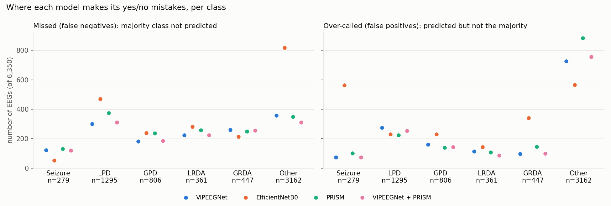
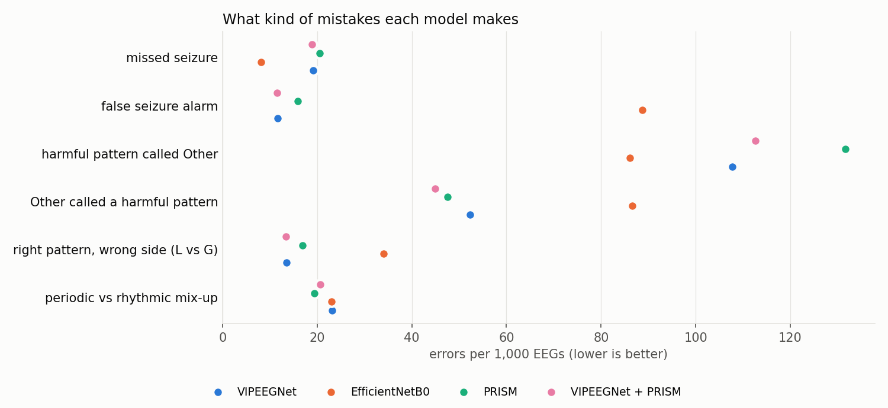
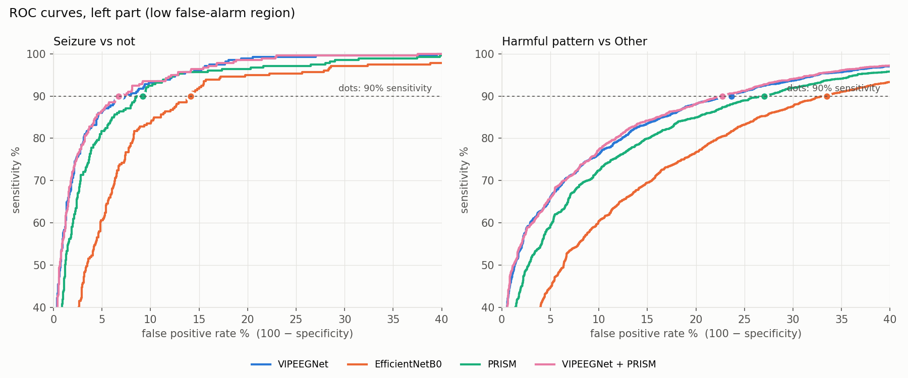
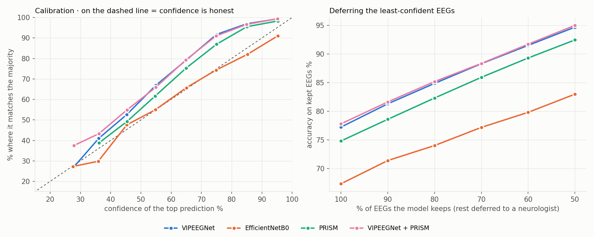
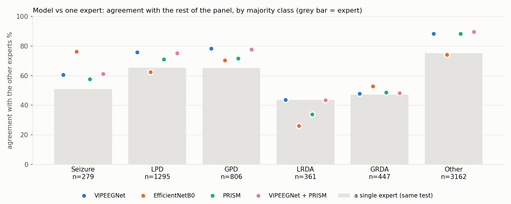
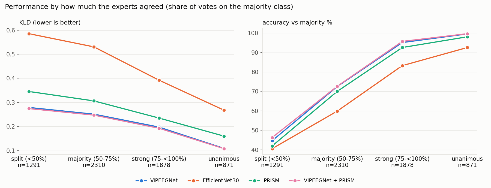

# HMS — ten evaluations of four models (2026-10-25)

6,350 EEG rows with >=10 votes, 1,063 patients. Reference: VIPEEGNet. 95% CIs resample patients.

## Scorecard

```
                                                                        VIPEEGNet  EfficientNetB0     PRISM  VIPEEGNet + PRISM               best
1 KLD (lower better)                                                       0.2217          0.4648    0.2732             0.2177  VIPEEGNet + PRISM
2 macro-F1 % (higher better)                                              66.2628         55.5827   62.5268            66.9880  VIPEEGNet + PRISM
3 macro-AUPRC (higher better)                                              0.7589          0.5936    0.6977             0.7633  VIPEEGNet + PRISM
4 harmful-vs-Other AUROC (higher better)                                   0.9291          0.8741    0.9125             0.9307  VIPEEGNet + PRISM
5 errors per 1,000 EEGs (lower better)                                   227.5591        326.6142  251.8110           221.8898  VIPEEGNet + PRISM
5b seizure errors per 1,000 EEGs, missed + false alarms (lower better)    30.8661         96.8504   36.3780            30.3937  VIPEEGNet + PRISM
6 seizure specificity % at 90% sensitivity (higher better)                92.8677         85.8508   90.8088            93.2960  VIPEEGNet + PRISM
7 class-wise ECE vs vote shares (lower better)                             0.0061          0.0448    0.0149             0.0074          VIPEEGNet
8 agreement with expert panel % (higher better)                           77.8464         67.1320   75.4195            78.3622  VIPEEGNet + PRISM
9 KLD on split-vote EEGs (lower better)                                    0.2791          0.5852    0.3455             0.2745  VIPEEGNet + PRISM
10 worst-decile patient KLD (lower better)                                 0.3950          1.0244    0.4783             0.3805  VIPEEGNet + PRISM
```

## 1. Distribution fit

```
                      KLD         KLD CI  Jensen-Shannon Jensen-Shannon CI  cross-entropy cross-entropy CI  total variation total variation CI  KLD vs VIPEEGNet             diff CI  P(better than ref)
model                                                                                                                                                                                                   
VIPEEGNet          0.2217  0.2117-0.2316          0.0565     0.0542-0.0586         0.8751    0.8370-0.9128           0.1949      0.1872-0.2019            0.0000  +0.0000 to +0.0000                 0.0
EfficientNetB0     0.4648  0.4391-0.4911          0.1067     0.1015-0.1117         1.1182    1.0700-1.1699           0.2929      0.2808-0.3045            0.2431  +0.2188 to +0.2664                 0.0
PRISM              0.2732  0.2587-0.2877          0.0672     0.0642-0.0700         0.9267    0.8840-0.9686           0.2193      0.2101-0.2279            0.0516  +0.0415 to +0.0635                 0.0
VIPEEGNet + PRISM  0.2177  0.2075-0.2274          0.0556     0.0534-0.0577         0.8711    0.8326-0.9095           0.1932      0.1856-0.2002           -0.0040  -0.0056 to -0.0023                 1.0
```

## 2. False negatives per class (count)

```
model    VIPEEGNet  EfficientNetB0  PRISM  VIPEEGNet + PRISM
class                                                       
Seizure        122              52    130                120
LPD            300             470    375                312
GPD            181             239    237                186
LRDA           223             282    258                224
GRDA           261             213    249                256
Other          358             818    350                311
```

## 2. False positives per class (count)

```
model    VIPEEGNet  EfficientNetB0  PRISM  VIPEEGNet + PRISM
class                                                       
Seizure         74             563    101                 73
LPD            275             231    224                253
GPD            160             231    139                143
LRDA           113             143    107                 87
GRDA            97             340    145                 98
Other          726             566    883                755
```

## 3. AUPRC per class

```
model    VIPEEGNet  EfficientNetB0   PRISM  VIPEEGNet + PRISM
class                                                        
Seizure     0.7222          0.4081  0.5753             0.7276
LPD         0.8777          0.7805  0.8544             0.8801
GPD         0.8768          0.7563  0.8472             0.8790
LRDA        0.5360          0.2784  0.4496             0.5447
GRDA        0.6098          0.4572  0.5439             0.6157
Other       0.9310          0.8809  0.9160             0.9328
```

## 4. Clinical decision tasks

```
                                                 n  positives   AUROC  sensitivity %  specificity %    PPV %    NPV %  false negatives  false positives
task                       model                                                                                                                       
Seizure vs not             VIPEEGNet          6350        279  0.9751        56.2724        98.7811  67.9654  98.0062              122               74
Harmful vs Other           VIPEEGNet          6350       3188  0.9291        77.2271        88.6781  87.3050  79.4334              726              358
Periodic vs rhythmic       VIPEEGNet          2909       2101  0.9700        94.6216        81.0644  92.8538  85.2865              113              153
Lateralized vs generalized VIPEEGNet          2909       1656  0.9859        94.9879        92.9769  94.7020  93.3494               83               88
Seizure vs not             EfficientNetB0     6350        279  0.9375        81.3620        90.7264  28.7342  99.0647               52              563
Harmful vs Other           EfficientNetB0     6350       3188  0.8741        82.2459        74.1303  76.2209  80.5498              566              818
Periodic vs rhythmic       EfficientNetB0     2909       2101  0.9458        91.7658        80.5693  92.4700  79.0049              173              157
Lateralized vs generalized EfficientNetB0     2909       1656  0.9348        85.0242        88.3480  90.6049  81.6974              248              146
Seizure vs not             PRISM              6350        279  0.9649        53.4050        98.3364  59.6000  97.8689              130              101
Harmful vs Other           PRISM              6350       3188  0.9125        72.3024        88.9311  86.8173  76.1028              883              350
Periodic vs rhythmic       PRISM              2909       2101  0.9641        91.6706        86.6337  94.6903  80.0000              175              108
Lateralized vs generalized PRISM              2909       1656  0.9772        92.8140        92.1788  94.0061  90.6593              119               98
Seizure vs not             VIPEEGNet + PRISM  6350        279  0.9757        56.9892        98.7976  68.5345  98.0386              120               73
Harmful vs Other           VIPEEGNet + PRISM  6350       3188  0.9307        76.3174        90.1645  88.6662  79.0627              755              311
Periodic vs rhythmic       VIPEEGNet + PRISM  2909       2101  0.9711        94.3836        82.9208  93.4936  85.0254              118              138
Lateralized vs generalized VIPEEGNet + PRISM  2909       1656  0.9861        94.8671        93.5355  95.0969  93.2379               85               81
```

## 5. Error types per 1,000 EEGs

```
model                               VIPEEGNet  EfficientNetB0     PRISM  VIPEEGNet + PRISM
error type                                                                                
missed seizure                        19.2126          8.1890   20.4724            18.8976
false seizure alarm                   11.6535         88.6614   15.9055            11.4961
harmful pattern called Other         107.7165         86.1417  131.6535           112.5984
Other called a harmful pattern        52.2835         86.6142   47.5591            44.8819
right pattern, wrong side (L vs G)    13.5433         34.0157   16.8504            13.3858
periodic vs rhythmic mix-up           23.1496         22.9921   19.3701            20.6299
all errors                           227.5591        326.6142  251.8110           221.8898
```

## 6. Specificity % at 90% sensitivity

```
model               VIPEEGNet  EfficientNetB0    PRISM  VIPEEGNet + PRISM
target                                                                   
Seizure               92.8677         85.8508  90.8088            93.2960
LPD                   89.7132         72.6212  87.8338            90.4847
GPD                   93.4343         86.2915  90.9812            93.5967
LRDA                  84.5884         64.7854  80.8148            84.9224
GRDA                  88.7854         76.6221  84.8552            88.5821
Other                 76.2547         60.4768  72.3965            77.3212
Harmful (any IIIC)    76.3441         66.5085  72.9602            77.2929
```

## 7. Calibration

```
                                class-wise ECE  top-label ECE  overconfidence (conf - acc)  mean confidence  accuracy %  Brier (vs vote shares)    AURC
model                                                                                                                                                  
VIPEEGNet                               0.0061         0.1027                      -0.1023           0.6702     77.2441                  0.0776  0.0758
EfficientNetB0                          0.0448         0.0231                       0.0134           0.6868     67.3386                  0.1840  0.1733
PRISM                                   0.0149         0.0721                      -0.0721           0.6761     74.8189                  0.1001  0.0963
VIPEEGNet + PRISM                       0.0074         0.1058                      -0.1058           0.6723     77.8110                  0.0762  0.0745
(experts: mean top vote share)             NaN            NaN                          NaN           0.7130         NaN                     NaN     NaN
```

## 7. Accuracy % when deferring

```
model       VIPEEGNet  EfficientNetB0    PRISM  VIPEEGNet + PRISM
coverage %                                                       
50            94.7087         82.9921  92.4724            95.0236
60            91.5223         79.8163  89.3176            91.7323
70            88.3240         77.1879  85.9393            88.3690
80            84.8819         74.0157  82.3228            85.1969
90            81.3123         71.3911  78.6002            81.6448
100           77.2441         67.3386  74.8189            77.8110
```

## 8. Model vs experts

```
                   model agreement % (LOO)  expert agreement % (LOO)  model - expert (points)  accuracy vs full majority %  top-2 accuracy %  Cohen's kappa vs majority
model                                                                                                                                                                  
VIPEEGNet                          77.8464                   67.0832                  10.7632                      77.2441           94.2835                     0.6551
EfficientNetB0                     67.1320                   67.0832                   0.0488                      67.3386           87.3228                     0.5388
PRISM                              75.4195                   67.0832                   8.3362                      74.8189           92.0000                     0.6138
VIPEEGNet + PRISM                  78.3622                   67.0832                  11.2790                      77.8110           94.2047                     0.6615
```

```
model    single expert  VIPEEGNet  EfficientNetB0    PRISM  VIPEEGNet + PRISM
class                                                                        
Seizure        51.0438    60.6348         76.3009  57.6613            61.1725
LPD            65.2967    75.8670         62.3767  71.0878            75.2187
GPD            65.1124    78.2265         70.4219  71.6820            77.6635
LRDA           43.7111    43.6675         26.1537  33.7400            43.4324
GRDA           47.2930    47.7187         52.9002  48.6389            48.2040
Other          75.1985    88.2400         74.1223  88.2574            89.5957
```

## 9. Uncertainty awareness

```
                   Spearman(model entropy, expert entropy)  mean model entropy  mean expert entropy
VIPEEGNet                                           0.7334              0.8469               0.6534
EfficientNetB0                                      0.5249              0.8375               0.6534
PRISM                                               0.6866              0.8431               0.6534
VIPEEGNet + PRISM                                   0.7379              0.8460               0.6534
```

## 10. Robustness

```
                   fold mean  fold std  worst fold  best fold  patient median  patient 90th pct  worst patient  % patients KLD > 0.5
model                                                                                                                               
VIPEEGNet             0.2221    0.0070      0.2319     0.2142          0.1740            0.3950         2.8426                5.3622
EfficientNetB0        0.4630    0.0330      0.5117     0.4282          0.3585            1.0244         3.7297               33.3960
PRISM                 0.2737    0.0115      0.2854     0.2590          0.2120            0.4783         2.9444                9.3133
VIPEEGNet + PRISM     0.2181    0.0074      0.2285     0.2089          0.1696            0.3805         2.8621                4.8918
```

```
                                     only first right  only second right  McNemar p  both wrong %  at least one right %  KLD error correlation
pair                                                                                                                                          
VIPEEGNet vs EfficientNetB0                      1068                439     0.0000       15.8425               84.1575                 0.4099
VIPEEGNet vs PRISM                                476                322     0.0000       17.6850               82.3150                 0.6764
VIPEEGNet vs VIPEEGNet + PRISM                     79                115     0.0118       20.9449               79.0551                 0.9868
EfficientNetB0 vs PRISM                           533               1008     0.0000       16.7874               83.2126                 0.3903
EfficientNetB0 vs VIPEEGNet + PRISM               409               1074     0.0000       15.7480               84.2520                 0.4247
PRISM vs VIPEEGNet + PRISM                        219                409     0.0000       18.7402               81.2598                 0.7608
```






